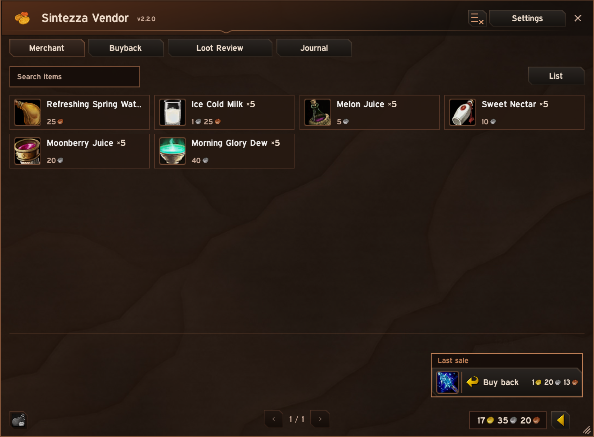
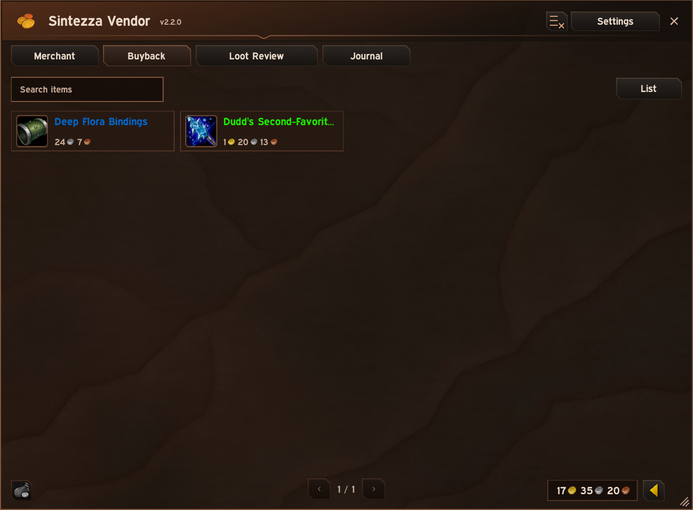
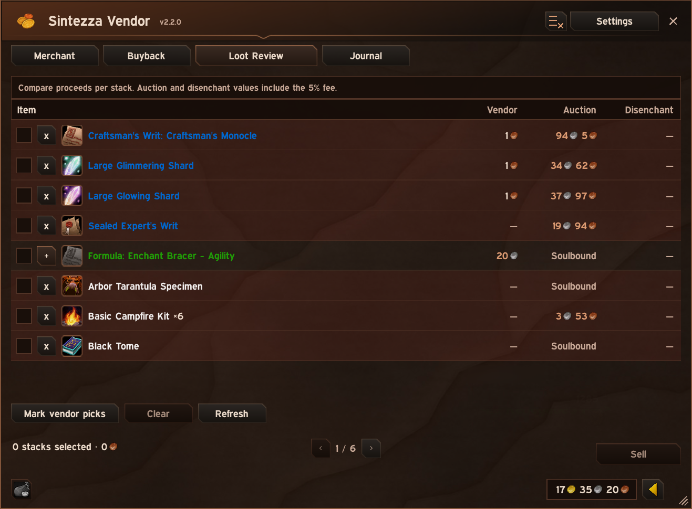
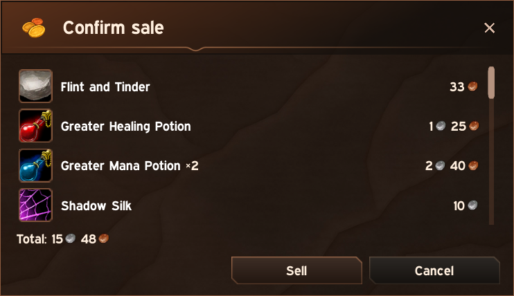
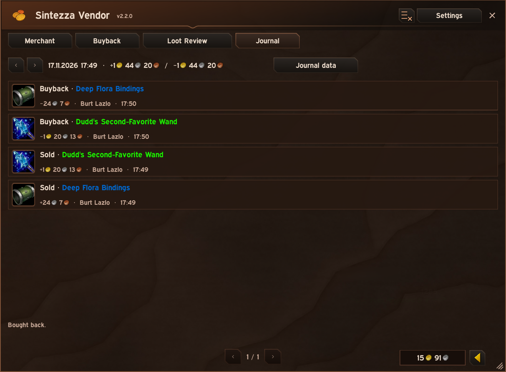
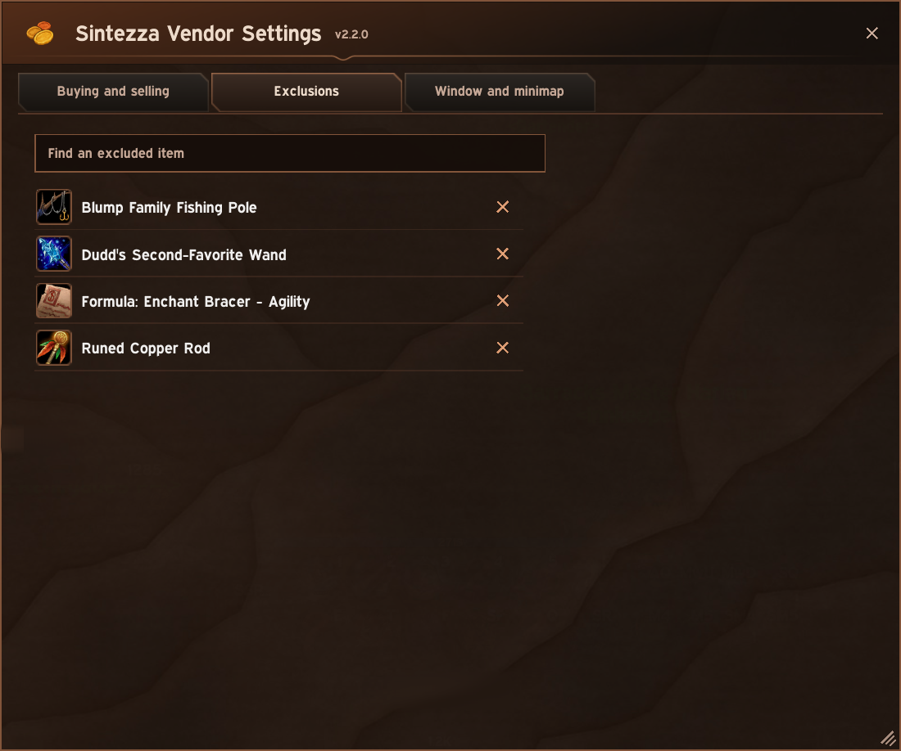

# Sintezza Vendor

| CurseForge field | Value |
| --- | --- |
| Game | World of Warcraft |
| Class | Addons |
| Flavor and version | Forever 1.60.1 |
| Main category | Bags & Inventory |
| Additional categories | Auction & Economy, Data Export |
| CurseForge relations | Sintezza Theme (Required Dependency), Mastercraft (Optional Dependency) |
| Project license | MIT. See the repository for third-party notices. |

## Summary

Search merchants and compare vendor, auction, and disenchant values in WoW Forever.

## Description

Sintezza Vendor gives WoW Forever merchants a searchable inventory and helps you compare what a stack is worth before you sell it.

### Merchant

Search stock by item name, switch between grid and list views, and repair gear from the merchant window.

### Buyback

Use **Last sale** to recover the most recently sold item. Open **Buyback** to see the other items you can still recover and their prices.

### Loot Review

Compare what the merchant pays with estimated auction proceeds after fees and estimated disenchant value. **Mark vendor picks** moves eligible stacks to the top and skips protected items and items Mastercraft recommends keeping, auctioning, or disenchanting. If Mastercraft shows advice only while you hold Shift, hold it when marking.

Check the selected stacks and the total in **Confirm sale** before you sell.

### Journal

Review purchases, sales, and buybacks for the current character. Open **Journal data** to export or import the history as CSV.

### Buying and selling settings

Set an instant purchase limit and choose whether to protect equipment sets, crafting materials, and known bound items.

Use **Exclusions** to keep individual items out of sales for this character.

### Appearance

**Requires [Sintezza Theme](https://github.com/ArtefactoO/Sintezza_Theme).** Open `/stheme` to choose the palette and fonts for this addon's windows.

### Requirements

Install [Mastercraft](https://www.curseforge.com/wow/addons/mastercraft) and enable its loot advice to use its recommendations and prices in **Loot Review**. [Auctionator](https://www.curseforge.com/wow/addons/auctionator) and [Sintezza Disenchant](https://github.com/ArtefactoO/Sintezza_Disenchant) can supply fallback estimates. The merchant, repair, buyback, and journal work with Theme alone.

<!-- Changelog field -->

### Changelog

[View the release history on GitHub](https://github.com/ArtefactoO/Sintezza_Vendor/blob/main/CHANGELOG.md).

Source, installation details, and credits are available on [GitHub](https://github.com/ArtefactoO/Sintezza_Vendor).
