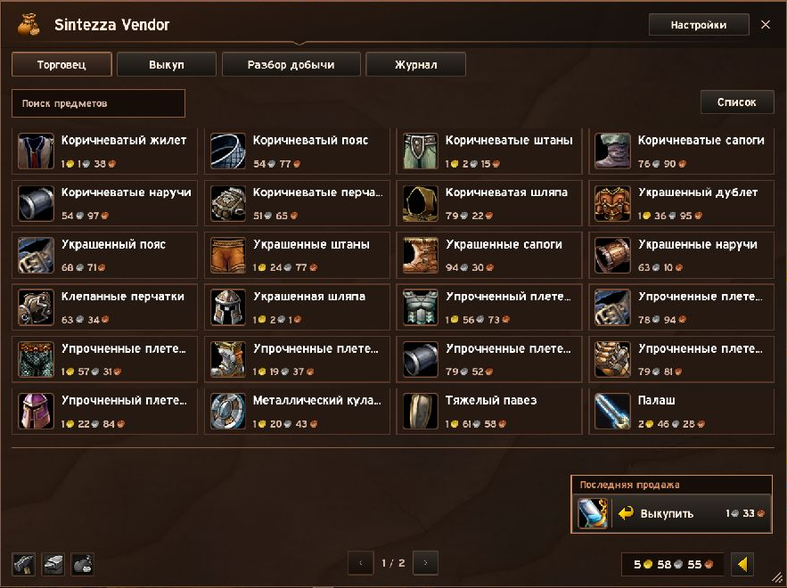
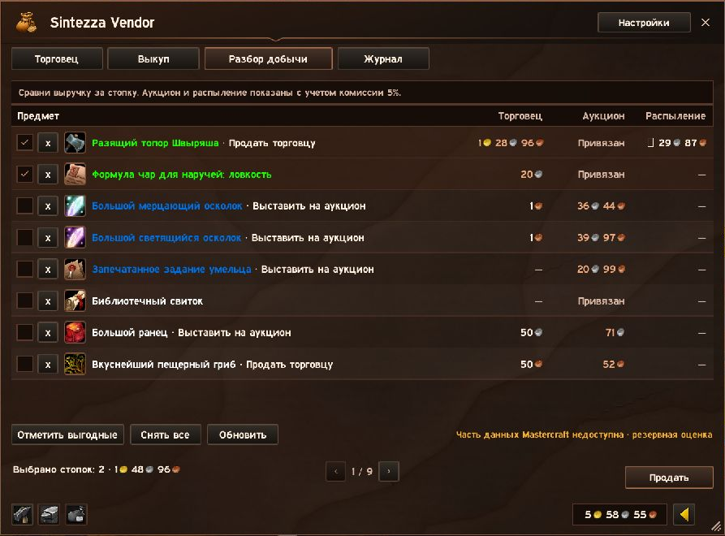
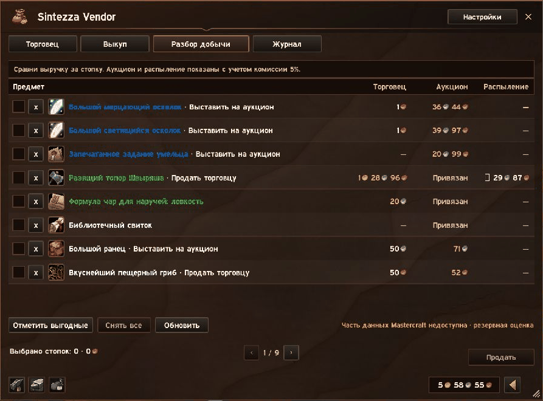

# Sintezza Vendor

Search merchant stock and compare the proceeds from selling, auctioning, and disenchanting gear in WoW Forever.

**Requires [Sintezza Theme](https://github.com/ArtefactoO/Sintezza_Theme).** Install [Mastercraft](https://www.curseforge.com/wow/addons/mastercraft) and enable its loot advice to use its recommendations and available prices in **Loot Review**. [Auctionator](https://www.curseforge.com/wow/addons/auctionator) and [Sintezza Disenchant](https://github.com/ArtefactoO/Sintezza_Disenchant) can supply fallback estimates. The merchant, bag sales, and transaction journal work with Sintezza Theme alone. Choose English or Russian in the theme settings.

## Shopping and selling

- Search the merchant catalogue by name in grid or list view. Use **Buyback** to recover sold items, and the arrow in the merchant window to switch to the standard WoW merchant.
- **Last sale** above the balance shows the most recently sold stack. Confirm its buyback to see the next available stack in the same place.
- Coin purchases within the configured limit go through immediately. The default limit is 100 gold. Set the limit to 0 in **Buying and selling** to confirm every purchase. Barter purchases and buybacks always ask for confirmation.
- The footer provides a junk sale with confirmation and repair at merchants who offer it. Automatic junk sale is available in settings.
- Open character exclusions from the merchant header or settings. Recognized fishing poles and selected profession tools in your bags are added automatically and announced in chat. Removing an exclusion manually prevents it from being re-added automatically for that character.
- **Journal** keeps confirmed Vendor transactions for each character and can display previous sessions. Open **Journal data** to export, import, or clear entries. Import merges matching data for the current character and retains up to 100 sessions.

## Loot review

Open the **Loot Review** tab in the merchant window to compare vendor proceeds with auction and disenchant estimates. The comparison applies the 5% auction fee once. **Mark vendor picks** selects stacks for which selling to the merchant has a strict price advantage. It skips protected items and items Mastercraft recommends keeping, auctioning, or disenchanting.

Mastercraft supplies advice and available prices first. If Mastercraft displays loot advice only while Shift is held, hold Shift when clicking **Mark vendor picks**. Auctionator and Sintezza Disenchant supply fallback estimates when available. Vendor identifies fallback data in the review, and **Sell** prompts for confirmation before proceeding.

| Command | Opens |
| --- | --- |
| `/svendor` | Settings |
| `/svendor merchant` | Catalogue at the current merchant |
| `/svendor review` | Loot review at the current merchant |
| `/svendor logs` | Transaction journal |

## Русский

Sintezza Vendor добавляет в WoW Forever окно торговца с поиском, разбором добычи и журналом. **Требуется Sintezza Theme.** В теме можно выбрать английский или русский язык. Mastercraft, Auctionator и Sintezza Disenchant можно подключить для советов и оценок.

- В каталоге есть сетка и список, поиск по названию, цены в золоте, жетонах и предметах. Стрелка переключает на штатное окно, значок мешочка возвращает в Vendor.
- Блок «Последняя продажа» над балансом показывает последнюю проданную стопку. После подтвержденного выкупа на ее месте появляется следующая.
- Покупки за монеты в пределах лимита проходят сразу. По умолчанию лимит равен 100 золотым. Введи 0 в разделе «Покупка и продажа», чтобы подтверждать каждую покупку. Обмен за валюту или предметы и выкуп всегда требуют подтверждения.
- Внизу окна доступны продажа хлама с подтверждением и ремонт у подходящих торговцев. Автопродажа хлама включается отдельно в настройках.
- Исключения персонажа открываются из шапки торговца или настроек. Распознанные удочки и некоторые инструменты профессий в сумках автоматически добавляются в исключения с сообщением в чат. Если снять исключение вручную, оно не будет добавлено автоматически повторно для этого персонажа.
- Вкладка «Разбор добычи» сравнивает выручку у торговца с аукционом и распылением. Комиссия 5% учитывается один раз. «Отметить выгодные» выбирает стопки, для которых торговец дает больше. Исключения и советы Mastercraft оставить, выставить или распылить предмет учитываются при выборе. Если совет по добыче Mastercraft появляется только с Shift, зажми Shift при отметке. Резервные оценки из Auctionator и Sintezza Disenchant помечаются отдельно.
- «Журнал» показывает подтвержденные покупки, продажи и выкуп текущего персонажа. «Данные журнала» открывают экспорт и импорт CSV и очистку. Импорт объединяет совпадающие записи и сохраняет до 100 сеансов.

Команды перечислены в таблице выше. Настройки также открываются кнопкой в шапке окна торговца.

## Gallery

## License and inspiration

Sintezza Vendor is available under the [MIT License](LICENSE). Sepheran’s Extended Vendor Forever inspired the searchable merchant catalogue. [Extended Vendor Forever](https://www.curseforge.com/wow/addons/extended-vendor-forever)

[CurseForge listing fields](CURSEFORGE.md)
