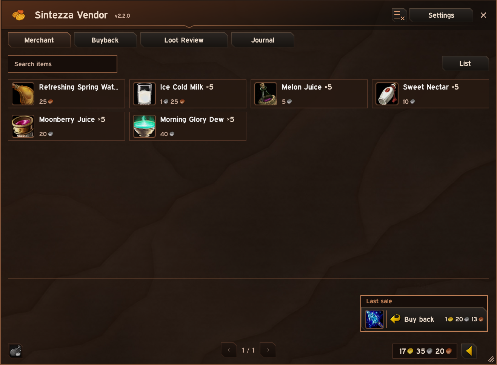
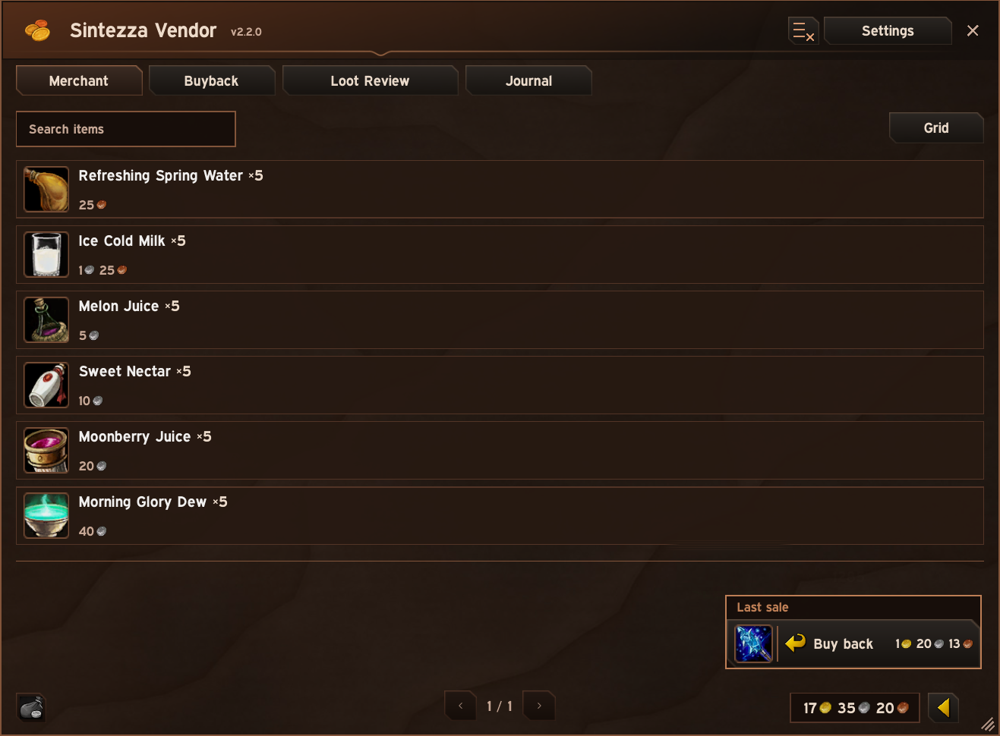
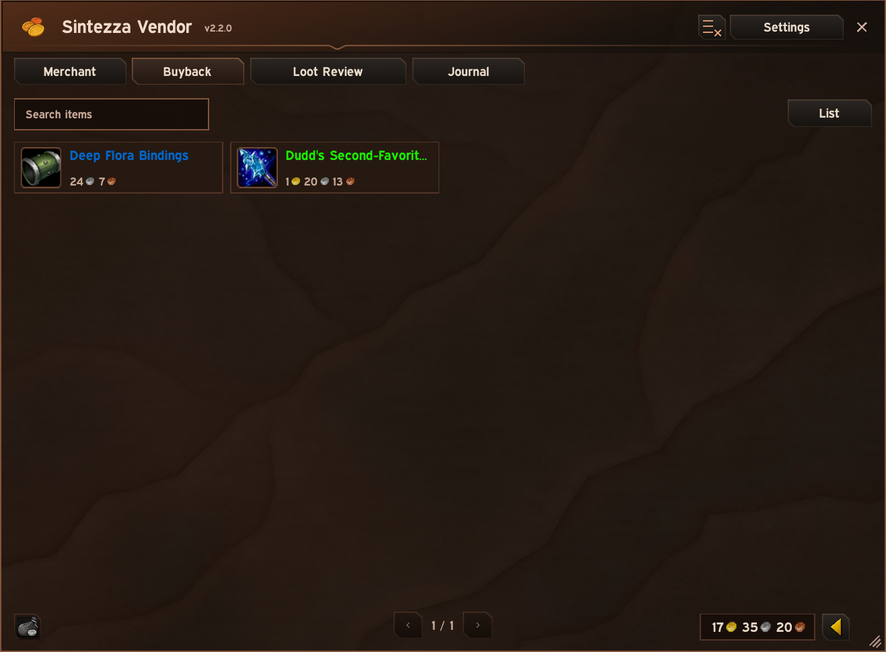
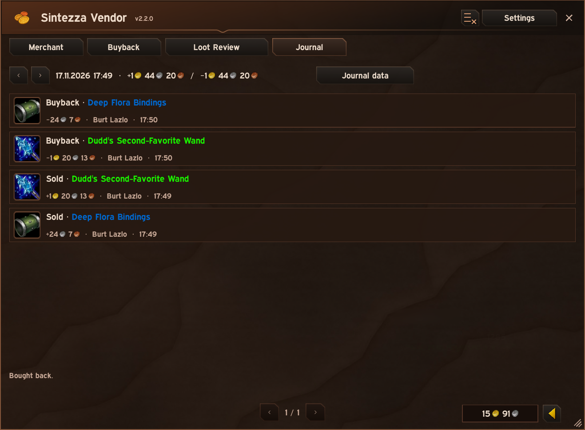
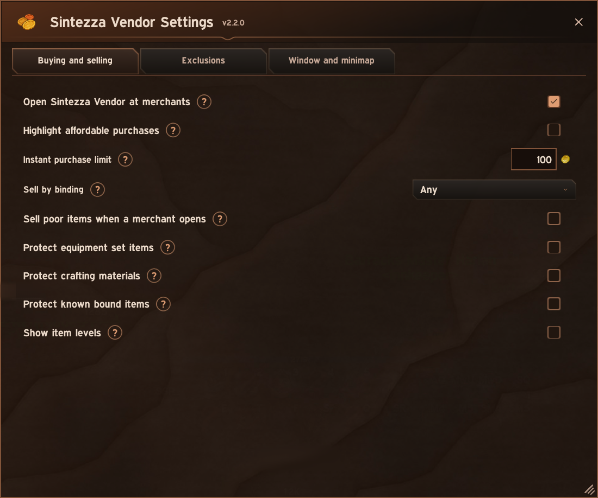
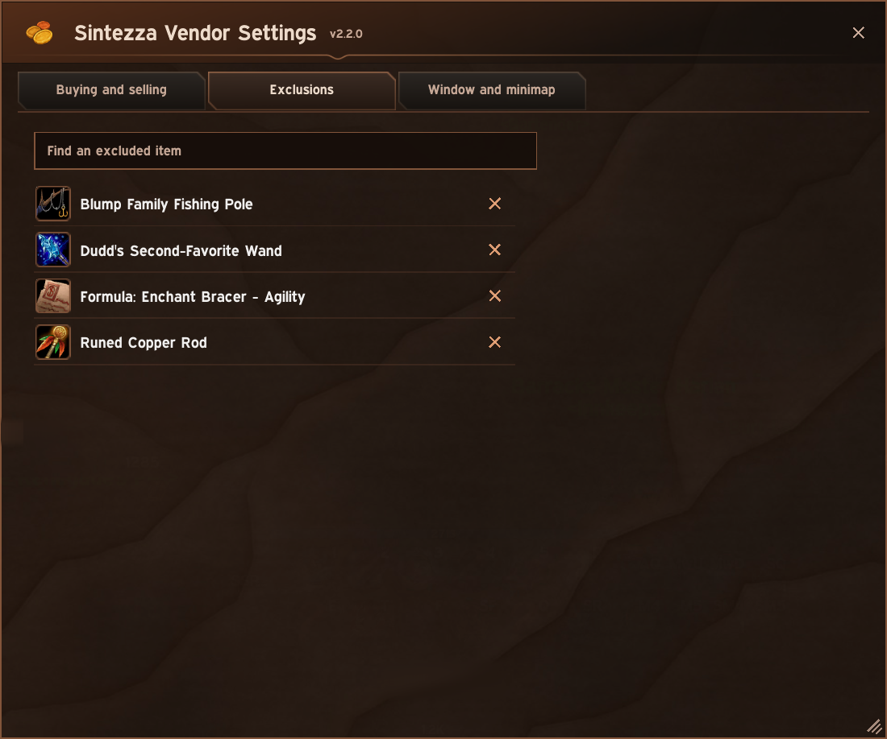

# Sintezza Vendor

Search merchant stock and compare the proceeds from selling, auctioning, and disenchanting gear in WoW Forever.

**Requires [Sintezza Theme](https://github.com/ArtefactoO/Sintezza_Theme).** Install [Mastercraft](https://www.curseforge.com/wow/addons/mastercraft) and enable its loot advice to use its recommendations and available prices in **Loot Review**. [Auctionator](https://www.curseforge.com/wow/addons/auctionator) and [Sintezza Disenchant](https://github.com/ArtefactoO/Sintezza_Disenchant) can supply fallback estimates. The merchant, bag sales, and transaction journal work with Sintezza Theme alone. Choose English or Russian in the theme settings.

## Shopping and selling

- Search the merchant catalogue by name in grid or list view. Use **Buyback** to recover sold items, and the arrow in the merchant window to switch to the standard WoW merchant.
- Right-click a catalogue item to choose how many to buy and see the total. **Max** fills the largest quantity you can buy in one transaction.
- **Last sale** above the balance shows the most recently sold stack. Confirm its buyback to see the next available stack in the same place.
- Coin purchases within the configured limit go through immediately. The default limit is 100 gold. Set the limit to 0 in **Buying and selling** to confirm every purchase. Barter purchases and buybacks always ask for confirmation.
- The footer provides a junk sale with confirmation and repair at merchants who offer it. Automatic junk sale is available in settings.
- Enable **Auto-repair** in **Buying and selling** to repair all items with your own gold when you visit a merchant who offers repairs. It is off by default.
- Sale confirmation lists each stack and its vendor price. Crafting materials can be selected manually unless their protection is enabled; automatic selection and junk sales always skip them.
- Loot Review tints items without a merchant price red and shows a reason below the list when an item is protected from selection.
- Open character exclusions from the merchant header or settings. Recognized fishing poles and selected profession tools in your bags are added automatically and announced in chat. Removing an exclusion manually prevents it from being re-added automatically for that character.
- **Journal** keeps confirmed Vendor transactions for each character and can display previous sessions. New entries include the merchant NPC ID when available, allowing the client to provide its localized name. Older entries without an NPC ID retain their saved merchant name. Open **Journal data** to export, import, or clear entries. Import merges matching data for the current character and retains up to 100 sessions.

## Loot review

Open the **Loot Review** tab in the merchant window to compare vendor proceeds with auction and disenchant estimates. The comparison applies the 5% auction fee once. **Mark vendor picks** selects stacks for which selling to the merchant has a strict price advantage. It skips protected items and items Mastercraft recommends keeping, auctioning, or disenchanting.

Mastercraft supplies advice and available prices first. If Mastercraft displays loot advice only while Shift is held, hold Shift when clicking **Mark vendor picks**. Auctionator and Sintezza Disenchant supply fallback estimates when available. Vendor identifies fallback data in the review, and **Sell** prompts for confirmation before proceeding.

| Command | Opens |
| --- | --- |
| `/svendor` | Settings |
| `/svendor merchant` | Catalogue at the current merchant |
| `/svendor review` | Loot review at the current merchant |
| `/svendor logs` | Transaction journal |

## Gallery

**Merchant catalogue.** Search stock, view prices, and buy back the last sale.

**Merchant list.** Switch from the grid to full-width rows with item names and prices.

**Buyback.** See which sold items you can recover and what each costs.

**Loot Review.** Compare merchant proceeds with estimated auction and disenchant values per stack.

**Confirm sale.** Check the selected stacks, their prices, and the total before selling.

**Transaction journal.** Review sales, buybacks, and session totals.

**Buying and selling settings.** Set a purchase limit, configure item protection, and choose whether to sell poor items at merchants.

**Character exclusions.** Search the protection list and remove individual items when needed.

## License and inspiration

Inspired by [Extended Vendor Forever](https://www.curseforge.com/wow/addons/extended-vendor-forever) by Sepheran. [MIT License](LICENSE).

[CurseForge listing fields](CURSEFORGE.md)
